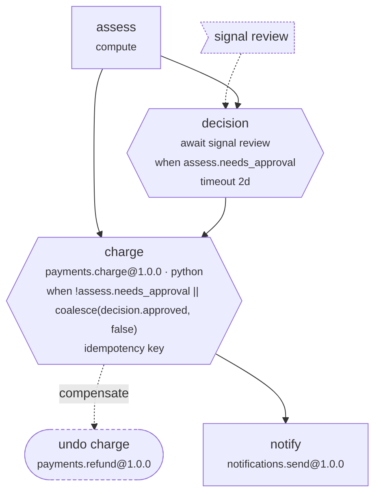

# Workflow `OrderApproval`

Charge an order, with a reviewer's approval above a threshold

|  |  |
|---|---|
| Version | `1.0.0` |
| Definition hash | `sha256:939fd564b818da34796032e2c0086ce2f28118e2e9f31a6d9c1b21fdbfc57066` |
| IR version | `orbit-ir/2` |
| Source | `examples/approval.orbit:12` |
| Workflow timeout | none |
| Limits | server defaults |

## Input

| Field | Type | Required | Default | Description |
|---|---|---|---|---|
| `order_id` | `String` | yes |  |  |
| `customer_id` | `String` | yes |  |  |
| `amount` | `Float` | yes |  |  |
| `currency` | `String` | no | `"USD"` |  |

## Output

| Field | Type | Description |
|---|---|---|
| `status` | `String` |  |
| `transaction_id` | `String?` |  |

```orbit
return { status: if is_null(charge) then "rejected" else "charged", transaction_id: charge.transaction_id }
```

## Signals

### Signal `review`

Received by `decision`.

| Field | Type | Required | Default | Description |
|---|---|---|---|---|
| `approved` | `Bool` | yes |  |  |
| `reviewer` | `String` | yes |  |  |
| `comment` | `String?` | no |  |  |

## Queries

| Query | Result type | Expression | Description |
|---|---|---|---|
| `status` | `{ needs_approval: Bool?, approved: Bool?, reviewer: String?, charged: Bool }` | `{ needs_approval: assess.needs_approval, approved: decision.approved, reviewer: decision.reviewer, charged: !is_null(charge) }` |  |

## Steps

In execution order. `After` lists direct dependencies, including those implied by reading another step's output.

| Step | Action | After | When | Retry | Timeouts | Compensation | Description |
|---|---|---|---|---|---|---|---|
| `assess` | compute `{ needs_approval: input.amount >= 1000.0, rounded: float(int(input.amount * 100.0)) / 100.0 }` |  |  |  |  |  |  |
| `decision` | `await review` | `assess` | `assess.needs_approval` |  | timeout 2d |  |  |
| `charge` | [`payments.charge`](contracts.md#task-payments-charge)@1.0.0 using `python` | `assess`, `decision` | `!assess.needs_approval \|\| coalesce(decision.approved, false)` |  | idempotency key `"charge-" + input.order_id` | [`payments.refund`](contracts.md#task-payments-refund)@1.0.0 |  |
| `notify` | [`notifications.send`](contracts.md#task-notifications-send)@1.0.0 | `charge` |  |  |  |  |  |

## Diagram



## Task contracts used

| Task | Version | Input | Output | Compensated by |
|---|---|---|---|---|
| [`notifications.send`](contracts.md#task-notifications-send) | `1.0.0` | `{ customer_id: String, message: String }` | `{ delivered: Bool }` |  |
| [`payments.charge`](contracts.md#task-payments-charge) | `1.0.0` | `PaymentRequest` | `PaymentResult` |  |
| [`payments.refund`](contracts.md#task-payments-refund) | `1.0.0` | `{ transaction_id: String, amount: Float }` | `{ refunded: Bool }` |  |
