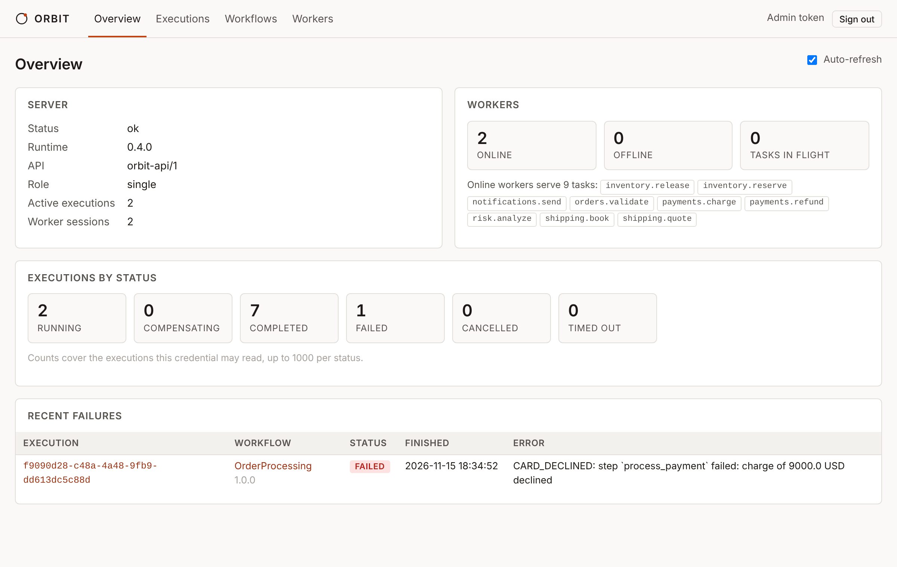
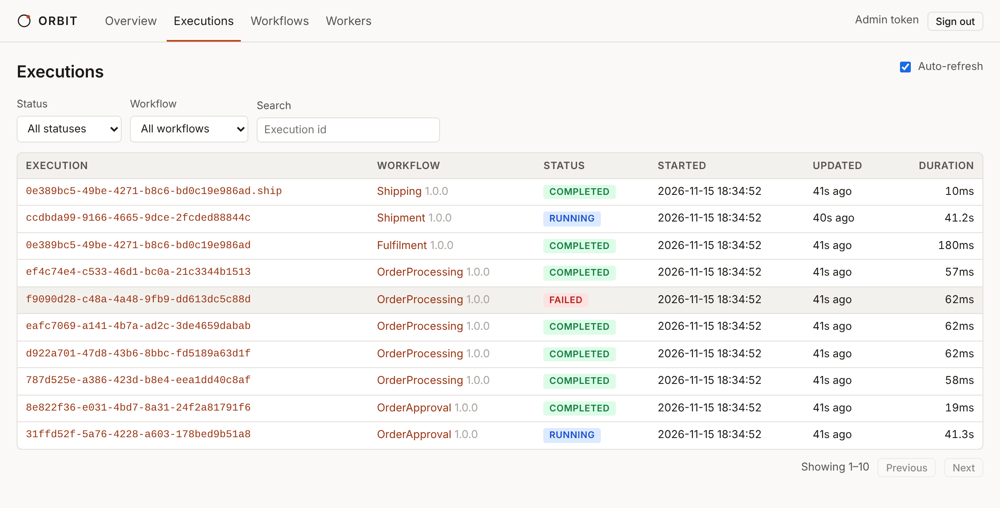
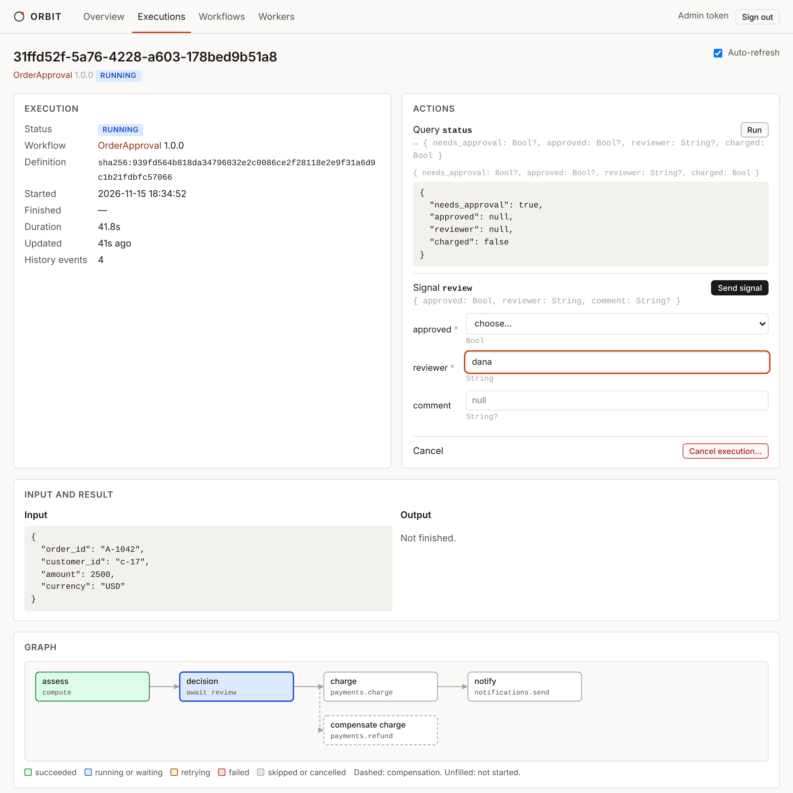
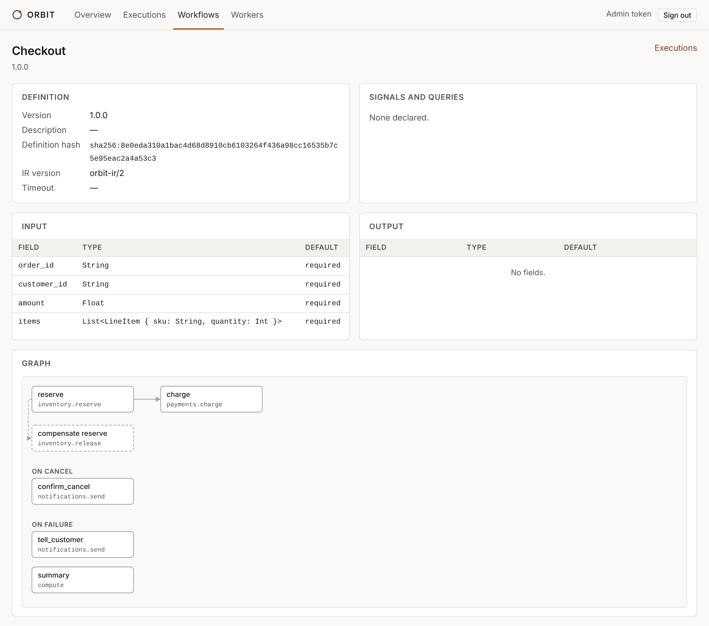

# Web UI

`orbit server` serves an operations UI at `/ui/` on the same address as the HTTP API. It shows the server's health, executions, their steps, history and graph, registered workflow definitions and connected workers, and it can run queries, send signals and cancel executions. This page describes each view, how sign-in and permissions work, the security headers, behaviour in a cluster, and the limitations.

The UI is three static files (HTML, CSS, JavaScript) compiled into the `orbit` binary. It loads nothing from the network other than the server it came from, needs no build step, and works offline. Every value it shows comes from the [HTTP API](../reference/http-api.md), called with the token you sign in with, so it can see and do exactly what that token can through the API.

## Opening it

Start a server and open its address in a browser:

```bash
orbit server
```

```text
http://127.0.0.1:7233/
```

`GET /` redirects browsers (requests whose `Accept` header contains `text/html`) to `/ui/`. Other clients get the API's JSON `404`:

```console
$ curl -s -o /dev/null -w "%{http_code} %{redirect_url}\n" -H "accept: text/html" http://127.0.0.1:7391/
302 http://127.0.0.1:7391/ui/
$ curl -s http://127.0.0.1:7391/
{"error":{"code":"NOT_FOUND","message":"no such endpoint; the API is under /v1/ and the web UI under /ui/"}}
```

To turn the UI off, start the server with `--no-ui` (or `ORBIT_NO_UI=true`). `/ui/` and the `/` redirect then do not exist; the API is unchanged.

## Signing in

When the server has no credentials configured (`orbit server` on a loopback address), the UI opens directly; the top bar says `No authentication configured`.

Otherwise the UI asks for a token. Enter either:

- the admin token (`--token` / `ORBIT_TOKEN`): every view and action; or
- a [client identity](security.md#client-identities) token: only the workflows and actions granted to that client.

The UI checks the token by reading `GET /v1/executions?limit=1`. A token the server does not accept is refused with `Token rejected`. Worker credentials cannot sign in: the API refuses them on the execution endpoints, and the UI shows that refusal.

The token is kept in the tab's `sessionStorage`: it is gone when the tab is closed, and **Sign out** removes it. It is sent with every request as `Authorization: Bearer <token>` and never appears in a URL or a cookie. If the server later refuses it with `401` (for example after the token was rotated), the UI returns to the sign-in page.

The UI does not authenticate with TLS client certificates. Its requests are made with `credentials: "omit"`, so a certificate installed in the browser is not sent; use a token.

## Client identities

A client identity sees the same data the API gives it:

| View | What a client sees |
|---|---|
| Overview | Server health (open to everyone), counts of the executions it may read, and its recent failures. The Workers panel shows `Not permitted`. |
| Executions | Only executions of workflows it may read (`read` action). Opening another execution shows `Not permitted`. |
| Execution detail | Queries, signals and cancel each work only if the action is granted. A refused action shows `Not permitted` with the API's message, for example ``client `billing` may not cancel executions of `OrderApproval` ``. |
| Workflows | Only definitions of workflows it may read. |
| Workers | `Not permitted` (`GET /v1/workers` is an administrative endpoint). |

The top bar shows which kind of credential is signed in, for example `Admin token` or `Client billing (restricted)`.

## Overview



| Panel | Contents | Source |
|---|---|---|
| Server | Status, runtime and API versions, role (`single`, `leader`, `standby` or `shared`), node id, term and leader in standby mode, active executions, worker sessions. In shared mode, also the executions owned and tasks claimed by this node, and a table of every node with its address, liveness and last heartbeat. | `GET /v1/health` |
| Workers | Online and offline workers, tasks in flight, and the tasks the online workers serve. | `GET /v1/workers` |
| Executions by status | One count per status, each linking to the filtered execution list. Counts are capped at 1000 per status (shown as `1000+`). | `GET /v1/executions?status=...&limit=1000` |
| Recent failures | The eight most recently updated `FAILED` or `TIMED_OUT` executions, with their error code and message. | the same lists, then `GET /v1/executions/{id}` |

## Executions



The list shows the execution id, workflow and version, status, start time, last update and duration (to now, for running executions), newest first, 25 per page. Above it:

- **Status** and **Workflow** filter on the server (`?status=` and `?workflow=` of `GET /v1/executions`).
- **Search** matches any part of an execution id among the newest 1000 executions that pass the filters. If nothing matches, the text is looked up as a complete id with `GET /v1/executions/{id}`, so an older execution can still be found by its full id.
- **Previous** and **Next** page through the list.

The filters and page are kept in the URL (for example `#/executions?status=FAILED&workflow=OrderProcessing`), so a filtered list can be bookmarked or shared.

## Execution detail



The detail page of one execution has these sections:

| Section | Contents |
|---|---|
| Execution | Status, workflow and version, definition hash, start and finish times, duration, time since the last update, number of history events. For a child execution, a link to its parent and the parent's step. While the execution winds down: the abort reason, compensation outcome and running `on` handler block. |
| Actions | One **Run** button per declared query, one form per declared signal, and **Cancel execution**. See below. |
| Input and result | The input, the output once completed, and the error if it failed, as JSON. |
| Graph | The workflow's steps drawn from the definition, coloured by the status of each step in this execution. See [Graph](#graph). |
| Steps | One row per unit: every step, every element of a `for` step (`reserve[0]`), every compensation (`compensate:charge`), every outcome handler step (`on_failure:tell_customer`), and every event handler instance and its steps (`on_event:location@4`, `on_event:location@4:tell`). Steps that have not started yet are listed as `not started`. Columns: action (task name, `compute`, `await <signal>`, `sleep`, `workflow <name>`), status, attempt (and the number of deliveries when an attempt was redelivered), the worker that ran it, start and finish times, time taken, and details: the last error, when a sleep or an `await` times out, when a retry is due, and the unit's input, output and idempotency key (expandable). |
| Child executions | For `workflow` steps that started, the child execution id (`<parent id>.<step>`, or `<parent id>.<step>.<index>` for `for` elements) with a link, its workflow and status. |
| Signals received | Every signal in arrival order: history sequence number, name, time received, the unit it was delivered to, and its payload. |
| History | Every history event: sequence number, time since the first event, event type, the unit or signal it concerns, and the absolute time. Click an event to see its full JSON. |

While the execution is running, the page reloads it and its history every 2 seconds (untick **Auto-refresh** to stop). Sections are redrawn only when a new event was recorded; the signal forms keep what you typed, and opened history events stay open.

### Queries

**Run** calls `GET /v1/executions/{id}/queries/{name}` and shows the result as JSON under the query's declared result type. On a finished execution, queries are answered from its final state.

### Signals

The form is generated from the signal's declared payload type. Required fields are marked `*`.

| Field type | Control |
|---|---|
| `Bool` | A list: `true`, `false`, and `null` (optional field) or `default (...)` (field with a default) |
| `Int`, `Float`, `Duration` | A number input |
| `String`, `UUID`, `Timestamp`, `Bytes` | A text input |
| anything else (records, lists, maps, `JSON`) | A JSON text area |

An empty field is left out of the payload, so the server applies the field's default, or leaves an optional field `null`. The payload is validated by the server, as for any other client: an invalid payload is refused with `SIGNAL_PAYLOAD_INVALID` and the server's message is shown under the form. An accepted signal shows its history sequence number, and the page refreshes.

### Cancel

**Cancel execution** opens a confirmation with an optional reason, recorded in the `CancelRequested` event. **Confirm cancel** calls `POST /v1/executions/{id}/cancel`. The button is disabled once the execution has finished.

## Graph

The graph is drawn from the workflow definition (`GET /v1/workflows/{name}/{version}`), the same on the execution page and the workflow page:



- Steps are placed in columns by the length of their longest dependency chain, so a step is always to the right of every step it depends on. Arrows are dependencies (`after`, and references to other steps' outputs).
- A step with a `compensate` block has a dashed node under it, connected by a dashed line.
- Outcome handlers (`on failure`, `on cancel`, `on timeout`) and event handlers (`on event <signal>`) are drawn as separate labelled lanes below the main steps, each with its own dependencies.
- The second line of each node is the action: task name, `compute`, `await <signal>`, `sleep <duration>`, `workflow <name>`, prefixed with `for <variable>:` for fan-out steps.
- On an execution page, nodes are coloured by status: green succeeded, blue running, dispatched or waiting, amber retrying or uncertain, red failed, grey skipped or cancelled, unfilled not started. A `for` step takes the status of its own unit, or else of its elements. An event handler step takes the status of its latest instance, and its name is followed by the number of instances (`tell ×2`). Hovering over a node shows its status and attempt.

Wide graphs scroll horizontally inside their panel.

## Workflows

The list shows every registered definition: name, version, description, number of steps, the tasks it uses (including child workflows as `workflow:<name>`), the start of the definition hash, and a link to its executions.

A definition's page shows its version, description, definition hash, IR version, workflow timeout and limits, links to its other registered versions, the input and output fields (type, default, or `required`), signals with their payload types, queries with their result types, the graph, a table of all steps (block, action, dependencies, whether it has a `when` condition, retry policy, timeout, compensation task), and the task contracts it was compiled against (name, version, input and output types, compensation, built-in or child workflow).

## Workers

One row per worker id: online or offline, runtime, SDK, number of sessions, tasks in flight, the tasks it serves (hover a task for its contract version), when it registered and when it was last seen. The list refreshes every 5 seconds. Source: `GET /v1/workers`.

## Security

The UI's files are served without authentication, so the sign-in page can load before you have entered a token. They are the same for every server and contain no data, configuration or secrets. All data is fetched from `/v1/*` with your token, so serving the UI adds no new endpoint or privilege. See [Security: web UI](security.md#web-ui).

Every UI response carries these headers:

```console
$ curl -sI http://127.0.0.1:7391/ui/
HTTP/1.1 200 OK
content-type: text/html; charset=utf-8
content-security-policy: default-src 'none'; script-src 'self'; style-src 'self'; img-src 'self' data:; connect-src 'self'; font-src 'self'; base-uri 'none'; form-action 'none'; frame-ancestors 'none'
x-content-type-options: nosniff
x-frame-options: DENY
referrer-policy: no-referrer
cross-origin-opener-policy: same-origin
cross-origin-resource-policy: same-origin
permissions-policy: camera=(), microphone=(), geolocation=(), payment=()
cache-control: no-cache
content-length: 1317
date: Sun, 15 Nov 2026 18:35:41 GMT
```

- The page has no inline script or style; the policy allows scripts and styles only from the server itself, and network requests only to the server itself.
- `frame-ancestors 'none'` and `X-Frame-Options: DENY` stop other sites from embedding the UI.
- Values from executions and definitions (ids, inputs, outputs, errors, payloads, step names) are inserted as text, never interpreted as markup.
- The UI shows values unredacted, as the API does. Anyone holding a token that may read an execution can see its inputs and outputs.

## Clusters

The UI is served by every server, whatever its role, because it is answered before the cluster logic.

**Standby mode** ([Running several servers](cluster.md)): on the leader, everything works. On a standby, the read views work, because a standby answers `GET` requests from the database; the Server panel shows `standby`, its term and the current leader. Running a query also works. Sending a signal or cancelling from a standby is refused with `503 NOT_LEADER`, and the UI shows the server's message, which names the leader and its address; open the leader's UI to act, or reach the UI through a load balancer that sends traffic to the ready server (`/v1/ready`), as for the API. Worker sessions are held by the leader, so on a standby the Workers view lists the registered workers as offline, and the active execution and worker session counts in the Server panel are 0; check those on the leader.

**Shared mode**: every server is active. Signals and cancellations sent from any node are forwarded to the node that owns the execution. The Server panel shows `shared`, the node's own executions and claimed tasks, and every node of the cluster with its liveness.

## Limitations

- The API returns at most 1000 executions per request and has no offset parameter. The list therefore pages through the newest 1000 executions that match the filters, the status counts stop at 1000, and the id search covers the newest 1000 (an older execution can be opened by its complete id).
- The UI polls; it does not receive pushed updates. Intervals: overview 5 s, execution list 3 s, execution detail 2 s while running, workers 5 s.
- The history is shown in full; executions with very many events make the detail page slower.
- The UI cannot start executions, register workflows or change server settings. Use the [CLI](../reference/cli.md) or the API.
- Times are shown in the browser's time zone.
- The UI is served at `/ui/` of the server's own address. Serving it under a path prefix of a reverse proxy has not been tested.
- It is tested with Chromium only (Playwright, in `tests/e2e/test_e2e.py`, class `WebUI`). It needs a current browser (it uses ES2021 JavaScript).
