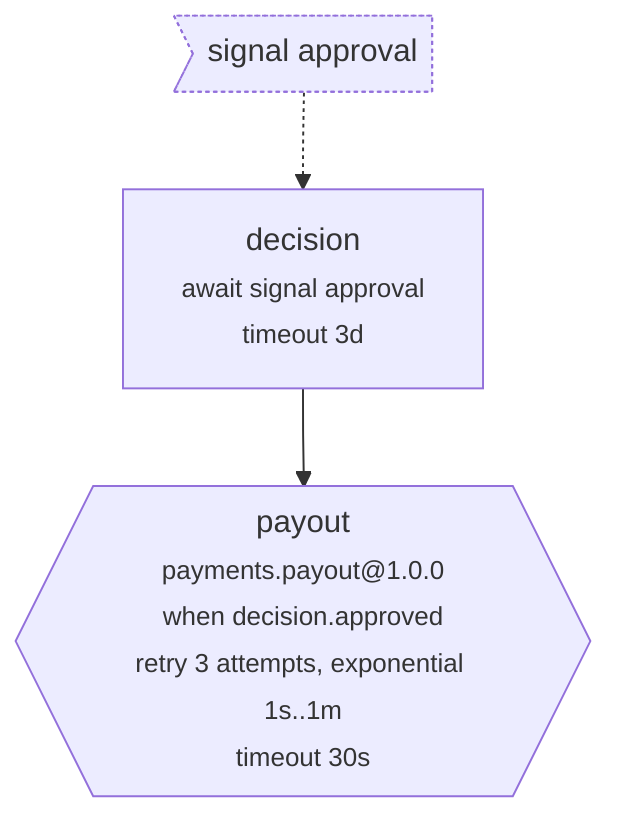

# Documentation generation

`orbit docs` turns `.orbit` files into reference documentation: one page per workflow, one page for the task contracts and an index. `orbit schema` exports JSON Schema for every payload that crosses the runtime's boundary. Both read the compiled definitions, so the documentation describes what the runtime executes, and both are deterministic, so the output can be committed and reviewed.

## Usage

```bash
orbit docs workflows/*.orbit --output build/docs                    # Markdown
orbit docs workflows/*.orbit --output build/docs --format html      # self-contained HTML
orbit docs workflows/*.orbit --output build/docs --json-schema      # also write schemas/
orbit schema workflows/*.orbit                                      # all schemas as one JSON object
orbit schema workflows/*.orbit --output build/schemas               # one file per schema
```

| Option | Default | Meaning |
|---|---|---|
| `<FILES>...` | required | `.orbit` files. Imports are followed. |
| `-o`, `--output <DIR>` | required | Output directory, created if needed. Existing files with the same names are overwritten; other files are left alone. |
| `--format <FORMAT>` | `markdown` | `markdown` writes `.md` files, `html` writes `.html` files. |
| `--json-schema` | off | Also write the JSON Schema files to `<DIR>/schemas` and add a "JSON Schema" table with links to each workflow page. |

The files must compile. Compilation errors are printed as with `orbit check` and the command exits `1` without writing anything. Warnings are printed and do not stop generation.

## Pages

| File | Content |
|---|---|
| `index.md` / `index.html` | Every workflow (version, number of steps, description) and every task contract (version, `compensated_by`), with links. |
| `<Workflow>.md` / `<Workflow>.html` | One page per workflow, described below. |
| `contracts.md` / `contracts.html` | Every task contract declared in the files, and every built-in task a workflow uses: doc comment, `description`, version, `compensated_by`, source location, the workflows that use it, and input and output field tables. Each contract has the anchor `task-<name>` with non-alphanumeric characters replaced by `-` (`#task-payments-charge`). |

A workflow page contains, in order:

| Section | Content |
|---|---|
| Title and text | The workflow's `///` doc comment, then its `description`. |
| Facts | Version, definition hash, IR version, source file and line, workflow `timeout`, `limits`. |
| Input | One row per field: path, type, required, default, doc comment. Fields of nested records, also inside lists (`items[].sku`), maps (`prices{}.amount`) and optionals, get their own rows. |
| Output | Path, type and doc comment of each field, then the `return` expression. |
| Signals | For each signal: doc comment, the steps that await it (or the `on event` block that handles it), and its fields. |
| Queries | Name, result type, expression and doc comment. |
| Steps | One row per step in execution order: action (task and contract version with a link to the contract, `using` language, child workflow, `sleep`, `await`, or the `compute` expression), fan-out (`for each ... in ...`, `max_parallel`), direct dependencies (explicit and implied), `when` condition, retry policy, timeouts and idempotency key, compensation, doc comment. |
| Outcome handlers | One steps table per `on failure`, `on cancel`, `on timeout` block. |
| Event handlers | One steps table per `on event <signal>` block. |
| Diagram | Markdown: the Mermaid flowchart from [`orbit graph`](graph.md) in a `mermaid` code block. HTML: the SVG rendering from `orbit graph --format svg`, inline, with the Mermaid source in a collapsed section. |
| Task contracts used | Each contract with its input and output types and `compensated_by`, and the child workflows the workflow starts. |
| JSON Schema | With `--json-schema`: links to the workflow's schema files. |

Expressions (conditions, step inputs, queries, `return`) are printed back as ORBIT source from the IR. Durations inside expressions appear as milliseconds.

### HTML

Each HTML page is a single file with its stylesheet and diagram inline: no scripts, no fonts, no images or stylesheets loaded from elsewhere, so a page can be attached to a ticket or archived as it is. Pages link to each other with relative links (`contracts.html#task-payments-charge`, `index.html`). Typography uses the system font stack; colours follow the light and dark tokens of the ORBIT website and switch with `prefers-color-scheme`.

## Doc comments

A doc comment is one or more `///` line comments directly above a declaration, each on its own line:

```orbit
/// Pays a refund back to the customer's card.
task "payments.payout" {
    version "1.0.0"
    input {
        /// Amount in the order currency.
        amount: Float
        order_id: String
    }
    output { payout_id: String }
}

/// Refunds an order after a support agent approves it.
///
/// Refunds of 500 or more need a second approval.
workflow Refund {
    version "1.0.0"
    input {
        /// The order to refund.
        order_id: String
        /// Amount to refund, at most the amount charged.
        amount: Float
    }
    output { payout_id: String? }

    /// Sent by the support tool when an agent decides.
    signal approval { approved: Bool, agent: String }

    /// Waits for the agent's decision.
    step decision {
        await approval
        timeout 3d
    }

    /// Pays the refund once approved.
    step payout {
        worker "payments.payout"
        when decision.approved
        with { amount: input.amount, order_id: input.order_id }
        retry { attempts: 3, backoff: exponential }
        timeout 30s
    }

    return { payout_id: payout.payout_id }
}
```

Doc comments are recognised on workflows, steps (also inside `on` blocks), signals, queries, task contracts, schemas, and fields of `input`, `output`, signal, schema and inline task records. The rules:

- Each line starts with `///` (after indentation). `////` and longer runs are ordinary comments.
- The block must be directly above the declaration: a blank line or an ordinary `//` comment between them ends it.
- The declaration must start its line. In `input { a: String, b: Int }` the fields cannot have doc comments; put each field on its own line.
- A line containing only `///` separates paragraphs. Workflow and contract doc comments keep their paragraphs; in table cells, lines are joined with spaces.
- The text is inserted as written. In HTML, `` `code` `` and `[text](url)` are rendered; other characters are escaped.

To the lexer, parser and formatter, a doc comment is an ordinary `//` comment. It does not change the definition hash, and `orbit fmt` keeps it in place.

## Example

```console
$ orbit docs refunds.orbit --output ref --json-schema
wrote ref/index.md
wrote ref/Refund.md
wrote ref/contracts.md
wrote 5 JSON Schema file(s) in ref/schemas
```

`ref/Refund.md`:

````markdown
# Workflow `Refund`

Refunds an order after a support agent approves it.

Refunds of 500 or more need a second approval.

|  |  |
|---|---|
| Version | `1.0.0` |
| Definition hash | `sha256:f6b6a421b594d654d63b901a2c2230fd93a08e81425c152c3481223a890a45ae` |
| IR version | `orbit-ir/2` |
| Source | `refunds.orbit:15` |
| Workflow timeout | none |
| Limits | server defaults |

## Input

| Field | Type | Required | Default | Description |
|---|---|---|---|---|
| `order_id` | `String` | yes |  | The order to refund. |
| `amount` | `Float` | yes |  | Amount to refund, at most the amount charged. |

## Output

| Field | Type | Description |
|---|---|---|
| `payout_id` | `String?` |  |

```orbit
return { payout_id: payout.payout_id }
```

## Signals

### Signal `approval`

Sent by the support tool when an agent decides.

Received by `decision`.

| Field | Type | Required | Default | Description |
|---|---|---|---|---|
| `approved` | `Bool` | yes |  |  |
| `agent` | `String` | yes |  |  |

## Steps

In execution order. `After` lists direct dependencies, including those implied by reading another step's output.

| Step | Action | After | When | Retry | Timeouts | Compensation | Description |
|---|---|---|---|---|---|---|---|
| `decision` | `await approval` |  |  |  | timeout 3d |  | Waits for the agent's decision. |
| `payout` | [`payments.payout`](contracts.md#task-payments-payout)@1.0.0 | `decision` | `decision.approved` | 3 attempts, exponential 1s..1m | timeout 30s |  | Pays the refund once approved. |

## Diagram



## Task contracts used

| Task | Version | Input | Output | Compensated by |
|---|---|---|---|---|
| [`payments.payout`](contracts.md#task-payments-payout) | `1.0.0` | `{ amount: Float, order_id: String }` | `{ payout_id: String }` |  |

## JSON Schema

| Payload | Schema |
|---|---|
| input | [`workflow.Refund.input.schema.json`](schemas/workflow.Refund.input.schema.json) |
| output | [`workflow.Refund.output.schema.json`](schemas/workflow.Refund.output.schema.json) |
| signal approval | [`workflow.Refund.signal.approval.schema.json`](schemas/workflow.Refund.signal.approval.schema.json) |
````

`ref/contracts.md`:

```markdown
# Task contracts

The typed interfaces that workers implement. Every step that calls a task is checked against its contract.

<a id="task-payments-payout"></a>

## `payments.payout`

Pays a refund back to the customer's card.

|  |  |
|---|---|
| Version | `1.0.0` |
| Source | `refunds.orbit:2` |
| Used by | [`Refund`](Refund.md) |

### Input

| Field | Type | Required | Default | Description |
|---|---|---|---|---|
| `amount` | `Float` | yes |  | Amount in the order currency. |
| `order_id` | `String` | yes |  |  |

### Output

| Field | Type | Description |
|---|---|---|
| `payout_id` | `String` |  |
```

The `Source` row shows the path as given on the command line, so run `orbit docs` from the same directory every time if the output is committed.

## JSON Schema

`orbit schema` (and `orbit docs --json-schema`) writes one [JSON Schema draft 2020-12](https://json-schema.org/draft/2020-12/schema) document per payload:

| Name | Payload |
|---|---|
| `workflow.<Workflow>.input` | Execution input (`POST /v1/executions`, `orbit run --input`) |
| `workflow.<Workflow>.output` | Execution result |
| `workflow.<Workflow>.signal.<signal>` | Signal payload (`orbit signal --data`) |
| `workflow.<Workflow>.query.<query>` | Query result |
| `task.<task>.input` | What a worker receives for the task |
| `task.<task>.output` | What a worker returns |

Without `--output`, `orbit schema` prints one JSON object that maps each name to its schema. With `--output <DIR>`, it writes `<DIR>/<name>.schema.json`. With `--workflow <NAME>`, only that workflow's schemas and the schemas of the task contracts it uses are exported. Child-workflow contracts are covered by the child's own `workflow.<Child>.*` schemas.

```console
$ orbit schema refunds.orbit -o schemas
wrote 5 JSON Schema file(s) in schemas
$ cat schemas/workflow.Refund.signal.approval.schema.json
{
  "$schema": "https://json-schema.org/draft/2020-12/schema",
  "$id": "urn:orbit:workflow.Refund.signal.approval@1.0.0",
  "title": "Refund@1.0.0 signal approval",
  "type": "object",
  "properties": {
    "approved": {
      "type": "boolean"
    },
    "agent": {
      "type": "string"
    }
  },
  "required": [
    "approved",
    "agent"
  ]
}
```

Each document has `$schema`, an `$id` of the form `urn:orbit:<name>@<version>` and a `title`. Types map as follows; the mapping follows the runtime's own payload validation:

| ORBIT type | JSON Schema |
|---|---|
| `String` | `{"type": "string"}` |
| `Int` | `{"type": "integer"}` with `minimum` and `maximum` of a signed 64-bit integer |
| `Float` | `{"type": "number"}` |
| `Bool` | `{"type": "boolean"}` |
| `Bytes` | `{"type": "string", "contentEncoding": "base64"}` |
| `Duration` | `{"type": "integer", "minimum": 0}` (milliseconds) |
| `Timestamp` | `{"type": "string", "format": "date-time"}` |
| `UUID` | `{"type": "string", "format": "uuid"}` |
| `JSON` | `true` (any value) |
| `List<T>` | `{"type": "array", "items": T}` |
| `Map<String, T>` | `{"type": "object", "additionalProperties": T}` |
| `T?` | `{"anyOf": [T, {"type": "null"}]}` |
| record | `{"type": "object", "properties": ..., "required": [...]}`, with `title` for named schemas and `default` for fields with defaults |

A field is in `required` unless it is optional or has a default. Workflow inputs are validated strictly by the runtime (unknown fields are rejected), so their records, including nested ones, have `"additionalProperties": false`. Signal payloads, task inputs and outputs, workflow outputs and query results allow extra fields, as the runtime does.

Differences from the runtime's checks: draft 2020-12 treats `format` and `contentEncoding` as annotations, so most validators accept any string for `Timestamp`, `UUID` and `Bytes` unless format validation is enabled; the runtime always checks them.

Validating a payload with Python's `jsonschema` package:

```python
import json
from jsonschema import Draft202012Validator

schema = json.load(open("schemas/workflow.Refund.input.schema.json"))
validator = Draft202012Validator(schema)
for error in validator.iter_errors({"order_id": "A-1", "amount": "12", "note": "x"}):
    print(error.message)
```

```text
'12' is not of type 'number'
Additional properties are not allowed ('note' was unexpected)
```

## In CI

Regenerate the reference on every change and fail if it is out of date:

```bash
orbit docs workflows/*.orbit --output docs/reference --json-schema
git diff --exit-code docs/reference
```

## See also

- [Workflow graphs](graph.md)
- [Process diffs](diff.md)
- [Task contracts](../language/tasks.md)
- [CLI: orbit docs](../reference/cli.md#orbit-docs), [orbit schema](../reference/cli.md#orbit-schema)
