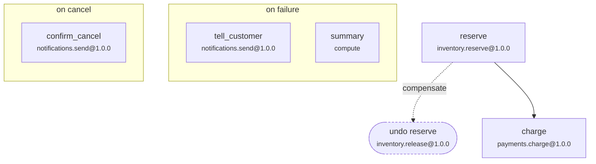

# Workflow graphs

`orbit graph` renders a workflow as a diagram: a Mermaid flowchart, a Graphviz (DOT) digraph, an SVG image, or a Mermaid sequence diagram of the calls the workflow makes. The diagram is drawn from the compiled definition, so it shows exactly what the runtime executes: implied dependencies, conditions, fan-out, retries, timeouts, compensations, outcome handlers and event handlers.

## Usage

```bash
orbit graph workflows/order.orbit                      # Mermaid flowchart, to stdout
orbit graph workflows/order.orbit --format dot         # Graphviz DOT
orbit graph workflows/order.orbit --format svg -o order.svg
orbit graph workflows/order.orbit --sequence           # Mermaid sequence diagram
orbit graph workflows/fulfilment.orbit --workflow Shipping
```

| Argument or option | Default | Meaning |
|---|---|---|
| `<FILE>` | required | A `.orbit` file or a compiled `.json` IR file. |
| `--workflow <NAME>` | see below | The workflow to render, when the file defines several. |
| `--format <FORMAT>` | `mermaid` | `mermaid`, `dot` or `svg`. |
| `--sequence` | off | Render a Mermaid sequence diagram instead of the step graph. Only with `--format mermaid`. |
| `-o`, `--output <PATH>` | stdout | Write to a file (parent directories are created) and print `wrote <PATH>` on stderr. |

Without `--workflow`, a file with one workflow renders that workflow, and a file with a parent workflow and its children renders the parent (the one workflow no other workflow in the file starts). Otherwise the command lists the workflows and asks you to choose:

```console
$ orbit graph examples/fulfilment.orbit --workflow Nope
error: no workflow `Nope`; available: Shipping, Fulfilment
```

The file must compile; compilation errors are printed as with `orbit check`, and the command exits with status `1`. `--sequence` with `--format dot` or `svg` is an error (status `1`).

## Deterministic output

The same definition always renders to the same text: steps appear in the IR's execution order (a stable topological order), dependencies are sorted, handlers appear in the order `failure`, `cancel`, `timeout`, and event blocks are sorted by signal. You can commit the diagram next to the workflow and review changes to it as a diff. The first comment lines carry the workflow name, version and definition hash, so a stale diagram is visible in review.

## What the graph shows

| Element | Mermaid | Graphviz | SVG |
|---|---|---|---|
| Step | rectangle `id["..."]` | rounded box | rounded box |
| Step with a `when` condition | hexagon `id{{"..."}}` | `shape=hexagon` | box with an accent border |
| Dependency (from `after` or from reading another step's output) | `a --> b` | `"a" -> "b"` | curved arrow |
| Compensation | stadium `<step>__undo(["undo <step>..."])` with class `compensation`, linked by `<step> -. compensate .-> <step>__undo` | dashed box, dashed edge labelled `compensate` | dashed box to the right of the step |
| Signal feeding an `await` step | flag `signal__<name>>"signal <name>"]`, dotted edge to the step | `shape=cds`, dashed edge | not drawn (the step label names the signal) |
| `on failure`, `on cancel`, `on timeout` | `subgraph on_<kind>["on <kind>"]` | dashed cluster `cluster_on_<kind>` | labelled panel below the main graph |
| `on event <signal>` | `subgraph on_event_<signal>["on event <signal>"]` | dashed cluster | labelled panel |

Node ids of handler and event steps are prefixed with the subgraph id (`on_failure__tell_customer`), so a handler step may share a name with a main step.

Each step's label lists, one per line:

| Line | When present | Example |
|---|---|---|
| step name | always | `charge` |
| action | always | `payments.charge@1.0.0 · python`, `child workflow Shipping`, `sleep 1h`, `await signal review`, `compute` |
| fan-out | `for` steps | `for each item (max 4 parallel)` |
| condition | `when` | `when analyze_risk.score < 0.8` |
| retry | more than one attempt | `retry 5 attempts, exponential 500ms..10s` |
| idempotency | `idempotency_key` | `idempotency key` |
| timeouts | `timeout`, `queue_timeout`, `await ... timeout` | `timeout 30s, queue 5m` |

Conditions are printed back as ORBIT expressions from the IR. Durations inside expressions appear as milliseconds, because the IR does not keep the unit. In Mermaid labels, `<`, `>`, `"` and `#` are written as the entities `#lt;`, `#gt;`, `#quot;` and `#35;`, which Mermaid renders as the characters.

The header comment also shows a workflow `timeout` and a `limits` block when present (`%% workflow timeout 5m`, `%% limits max_history_events 5000`).

## Mermaid

A real diagram of [`examples/checkout.orbit`](https://github.com/AjmalX0/Orbit/blob/main/examples/checkout.orbit):

```console
$ orbit graph examples/checkout.orbit
```



This documentation is built without a Mermaid plugin, so the block above shows as source. GitHub and GitLab render `mermaid` code blocks in Markdown files, issues and pull requests. The same workflow rendered by `orbit graph examples/checkout.orbit --format svg`:


A workflow with conditions, retries and compensations ([`examples/order_processing.orbit`](https://github.com/AjmalX0/Orbit/blob/main/examples/order_processing.orbit)):

```text
flowchart TD
    %% OrderProcessing@1.0.0
    %% sha256:4fdfac082bf3f2fbbbc8ac5465d37cba01dffd1b8e4ae08e25be3e0d76486c41
    %% workflow timeout 5m
    classDef compensation stroke-dasharray: 4 3
    classDef signal stroke-dasharray: 2 2
    validate_order["validate_order<br/><small>orders.validate@1.0.0 · typescript</small><br/><small>timeout 10s</small>"]
    analyze_risk["analyze_risk<br/><small>risk.analyze@1.0.0 · python</small><br/><small>retry 3 attempts, exponential 1s..30s</small>"]
    reserve_inventory["reserve_inventory<br/><small>inventory.reserve@1.0.0 · typescript</small>"]
    validate_order --> reserve_inventory
    reserve_inventory__undo(["undo reserve_inventory<br/><small>inventory.release@1.0.0</small>"]):::compensation
    reserve_inventory -. compensate .-> reserve_inventory__undo
    process_payment{{"process_payment<br/><small>payments.charge@1.0.0 · python</small><br/><small>when analyze_risk.score #lt; 0.8</small><br/><small>retry 5 attempts, exponential 500ms..10s</small><br/><small>idempotency key</small><br/><small>timeout 30s</small>"}}
    analyze_risk --> process_payment
    reserve_inventory --> process_payment
    process_payment__undo(["undo process_payment<br/><small>payments.refund@1.0.0</small>"]):::compensation
    process_payment -. compensate .-> process_payment__undo
    send_notification["send_notification<br/><small>notifications.send@1.0.0 · typescript</small>"]
    process_payment --> send_notification
```

`process_payment` depends on `analyze_risk` because its condition reads `analyze_risk.score`, even though its `after` names only `reserve_inventory`.

A `for` step and a child workflow ([`examples/fulfilment.orbit`](https://github.com/AjmalX0/Orbit/blob/main/examples/fulfilment.orbit)):

```console
$ orbit graph examples/fulfilment.orbit --workflow Fulfilment
```

```text
flowchart TD
    %% Fulfilment@1.0.0
    %% sha256:ecffc60c3bd361d5112497749c532dc808cbe2db9f35af22c1ffee8f2f9d90d3
    classDef compensation stroke-dasharray: 4 3
    classDef signal stroke-dasharray: 2 2
    reserve["reserve<br/><small>inventory.reserve@1.0.0 · typescript</small><br/><small>for each item (max 4 parallel)</small>"]
    reserve__undo(["undo reserve<br/><small>inventory.release@1.0.0</small>"]):::compensation
    reserve -. compensate .-> reserve__undo
    ship["ship<br/><small>child workflow Shipping</small><br/><small>timeout 1h</small>"]
```

The child workflow is a single node. Render it separately with `--workflow Shipping`.

To produce an image from Mermaid source, use the Mermaid CLI:

```bash
orbit graph workflows/order.orbit -o order.mmd
npx -y @mermaid-js/mermaid-cli -i order.mmd -o order.svg
```

## Graphviz

```console
$ orbit graph examples/shipment.orbit --format dot
```

```text
digraph "Shipment" {
  // Shipment@1.0.0
  // sha256:dc7d17291b8a4c9bcea44a73e12a8bbde9f20ec9d36f5447ea90d42882f4154d
  // limits max_history_events 5000
  rankdir=TB;
  node [shape=box, style=rounded, fontname="Helvetica", fontsize=11];
  edge [fontname="Helvetica", fontsize=10];
  "signal__delivered" [label="signal delivered", shape=cds, style=dashed];
  "arrival" [label="arrival\nawait signal delivered\ntimeout 30d"];
  "signal__delivered" -> "arrival" [style=dashed];
  "confirm" [label="confirm\nnotifications.send@1.0.0"];
  "arrival" -> "confirm";
  subgraph "cluster_on_event_location" {
    label="on event location";
    style=dashed;
    "on_event_location__text" [label="text\ncompute"];
    "on_event_location__tell" [label="tell\nnotifications.send@1.0.0"];
    "on_event_location__text" -> "on_event_location__tell";
  }
}
```

Render it with Graphviz:

```bash
orbit graph workflows/order.orbit --format dot | dot -Tsvg -o order.svg
orbit graph workflows/order.orbit --format dot | dot -Tpng -o order.png
```

## SVG without external tools

`--format svg` lays the graph out itself and writes a standalone SVG document; neither Graphviz nor a browser is needed. The layout is simple and deterministic:

- each step is placed one layer below its deepest dependency (longest path from the steps without dependencies), and steps in a layer keep the execution order;
- a compensation is placed to the right of the step it undoes, on the same layer;
- each outcome handler and event block is laid out the same way in its own labelled panel, below the main graph;
- dependencies are curves from the bottom of a step to the top of its dependent. An edge that skips a layer can pass behind a node of the layer in between; use Graphviz for large graphs where that matters.

The SVG uses a monospace font, embeds its own stylesheet (colours follow `prefers-color-scheme`) and has a transparent background. `orbit docs --format html` embeds the same rendering in each workflow page.

## Sequence diagrams

`--sequence` renders the calls a workflow makes as a Mermaid sequence diagram:

```console
$ orbit graph examples/approval.orbit --sequence
```

```text
sequenceDiagram
    %% OrderApproval@1.0.0
    %% sha256:939fd564b818da34796032e2c0086ce2f28118e2e9f31a6d9c1b21fdbfc57066
    participant W as OrderApproval
    participant Sender
    participant payments
    participant notifications
    Note over W: assess: compute
    opt when assess.needs_approval
        Sender->>W: decision: signal review (timeout 2d)
    end
    opt when !assess.needs_approval || coalesce(decision.approved, false)
        W->>+payments: charge: payments.charge@1.0.0
        payments-->>-W: PaymentResult
    end
    W->>+notifications: notify: notifications.send@1.0.0
    notifications-->>-W: { delivered }
    opt compensation, in reverse order, after a failure or cancellation
        W->>+payments: undo charge: payments.refund@1.0.0
        payments-->>-W: { refunded }
    end
```

| Element | Drawn as |
|---|---|
| Worker task | a call to a participant named after the task's namespace (`payments` for `payments.charge`) and a reply with the contract's output type (a record's name, or its field names) |
| Child workflow | a call to the participant `child_<Name>` |
| `await` | a message from the participant `Sender` |
| `sleep`, `compute` | a note over the workflow |
| `when` | an `opt when <condition>` block |
| `for` | a `loop for each <variable>` block |
| Compensations | one `opt compensation ...` block at the end, in reverse execution order |
| Handlers and event blocks | one `opt on <kind>` or `opt on event <signal>` block each |

Steps appear in execution order. Steps that can run concurrently are drawn one after the other; the flowchart shows which steps are independent.

## In VS Code

**ORBIT: Show Step Graph (Mermaid)** runs `orbit graph` on the current file and opens the Mermaid source beside the editor. See [Editor support](editors.md).

## See also

- [Documentation generation](docs-generation.md): the same diagram inside a reference page
- [Dependencies](../language/dependencies.md)
- [Fan-out](../language/fan-out.md)
- [Child workflows](../language/child-workflows.md)
- [CLI: orbit graph](../reference/cli.md#orbit-graph)
- [Editor support](editors.md)
