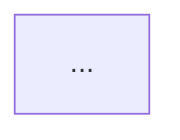

# Workflow graphs

`orbit graph` renders a workflow's steps and their dependencies as a diagram, in Mermaid or Graphviz (DOT) syntax. Use it to review a workflow's structure, to document it, or to check that dependencies are what you intended. The graph is drawn from the compiled definition, so it reflects exactly what the runtime will execute.

## Usage

```bash
orbit graph workflows/order.orbit                     # Mermaid, to stdout
orbit graph workflows/order.orbit --format dot        # Graphviz DOT
orbit graph workflows/fulfilment.orbit --workflow Shipping
```

| Argument or option | Default | Meaning |
|---|---|---|
| `<FILE>` | required | A `.orbit` file or a compiled `.json` IR file. |
| `--workflow <NAME>` | see below | The workflow to render, when the file defines several. |
| `--format <FORMAT>` | `mermaid` | `mermaid` or `dot`. |

Without `--workflow`, a file with one workflow renders that workflow, and a file with a parent workflow and its children renders the parent (the one workflow no other workflow in the file starts). Otherwise the command lists the workflows and asks you to choose:

```console
$ orbit graph examples/fulfilment.orbit --workflow Nope
error: no workflow `Nope`; available: Shipping, Fulfilment
```

The file must compile; compilation errors are printed as with `orbit check`, and the command exits with status `1`.

## What the graph shows

| Element | Mermaid | Graphviz |
|---|---|---|
| Step | rectangle `["..."]` | rounded box |
| Step with a `when` condition | rhombus `{"..."}` | `shape=diamond` |
| Dependency (from `after` or from reading another step's output) | `a --> b` | `"a" -> "b"` |
| Compensation | dotted edge `-. compensate .->` to a stadium node `<step>_undo` | dashed edge and dashed node `<step>_undo` |

Each step's label contains the step name and what it runs:

| Step kind | Mermaid label | Graphviz label |
|---|---|---|
| Worker task | task name, and `· <language>` with `using` | task name |
| `sleep` | `sleep <duration>` | `sleep <duration>` |
| Child workflow | `child workflow <Name>` | `child workflow:<Name>` |
| `await` | `await signal <signal>` | `await <signal>` |
| `compute` | `compute` | `compute` |
| `for` step | adds `for each <variable>` | adds `for each <variable>` |

Mermaid output starts with a comment that names the workflow and version (`%% OrderProcessing@1.0.0`).

## Mermaid

```console
$ orbit graph examples/order_processing.orbit
```

```text
flowchart TD
    %% OrderProcessing@1.0.0
    validate_order["validate_order<br/><small>orders.validate · typescript</small>"]
    analyze_risk["analyze_risk<br/><small>risk.analyze · python</small>"]
    reserve_inventory["reserve_inventory<br/><small>inventory.reserve · typescript</small>"]
    validate_order --> reserve_inventory
    reserve_inventory -. compensate .-> reserve_inventory_undo(["inventory.release"])
    process_payment{"process_payment<br/><small>payments.charge · python</small>"}
    analyze_risk --> process_payment
    reserve_inventory --> process_payment
    process_payment -. compensate .-> process_payment_undo(["payments.refund"])
    send_notification["send_notification<br/><small>notifications.send · typescript</small>"]
    process_payment --> send_notification
```

`process_payment` is a rhombus because it has a `when` condition, and it depends on `analyze_risk` because its condition reads `analyze_risk.score`, even though its `after` names only `reserve_inventory`.

Mermaid renders natively in GitHub and GitLab Markdown. Wrap the output in a fenced code block with the language `mermaid`:

````markdown

````

To produce an image, use the Mermaid CLI:

```bash
orbit graph workflows/order.orbit > order.mmd
npx -y @mermaid-js/mermaid-cli -i order.mmd -o order.svg
```

A workflow with fan-out and a child workflow (`examples/fulfilment.orbit`):

```text
flowchart TD
    %% Fulfilment@1.0.0
    reserve["reserve<br/><small>inventory.reserve · typescript</small><br/><small>for each item</small>"]
    reserve -. compensate .-> reserve_undo(["inventory.release"])
    ship["ship<br/><small>child workflow Shipping</small>"]
```

The child workflow is a single node. Render it separately with `--workflow Shipping`.

## Graphviz

```console
$ orbit graph examples/order_processing.orbit --format dot
```

```text
digraph "OrderProcessing" {
  rankdir=TB;
  node [shape=box, style=rounded];
  "validate_order" [label="validate_order\norders.validate"];
  "analyze_risk" [label="analyze_risk\nrisk.analyze"];
  "reserve_inventory" [label="reserve_inventory\ninventory.reserve"];
  "validate_order" -> "reserve_inventory";
  "reserve_inventory_undo" [label="inventory.release", style=dashed];
  "reserve_inventory" -> "reserve_inventory_undo" [style=dashed, label="compensate"];
  "process_payment" [label="process_payment\npayments.charge", shape=diamond];
  "analyze_risk" -> "process_payment";
  "reserve_inventory" -> "process_payment";
  "process_payment_undo" [label="payments.refund", style=dashed];
  "process_payment" -> "process_payment_undo" [style=dashed, label="compensate"];
  "send_notification" [label="send_notification\nnotifications.send"];
  "process_payment" -> "send_notification";
}
```

Render it with Graphviz:

```bash
orbit graph workflows/order.orbit --format dot | dot -Tsvg -o order.svg
orbit graph workflows/order.orbit --format dot | dot -Tpng -o order.png
```

```console
$ orbit graph examples/fulfilment.orbit --workflow Shipping --format dot
```

```text
digraph "Shipping" {
  rankdir=TB;
  node [shape=box, style=rounded];
  "quote" [label="quote\nshipping.quote"];
  "book" [label="book\nshipping.book"];
  "quote" -> "book";
}
```

## In VS Code

**ORBIT: Show Step Graph (Mermaid)** runs `orbit graph` on the current file and opens the Mermaid source beside the editor. See [Editor support](editors.md).

## See also

- [Dependencies](../language/dependencies.md)
- [Fan-out](../language/fan-out.md)
- [Child workflows](../language/child-workflows.md)
- [CLI: orbit graph](../reference/cli.md#orbit-graph)
- [Editor support](editors.md)
